# PinFall — an alternative Pinterest client in C + SDL2

A native, lightweight desktop client for Pinterest built from scratch:
**C11 + SDL2 + libcurl + stb_image**, with a hand-rolled reverse-engineered
guest API layer and a masonry feed UI.

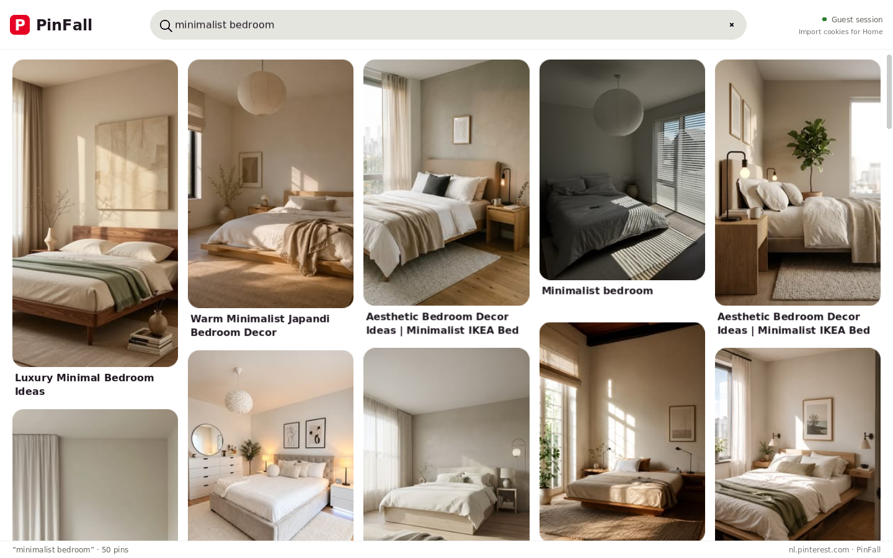

Detail overlay (click a pin): 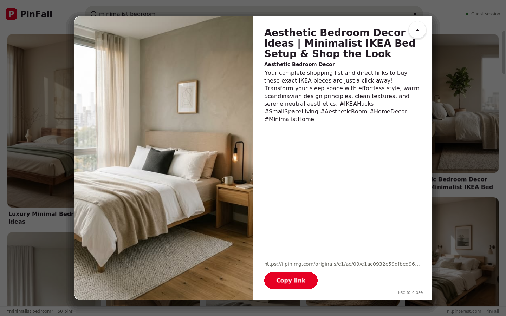

Rendered from a real run against `nl.pinterest.com` (50 pins, live images).

Signed-in layout (Home tab + username chip; rendered with `--auth-preview`,
placeholder username, no real account session):


Saved tab and the save flow (preview data / placeholder boards — the same UI is
used with a real session):


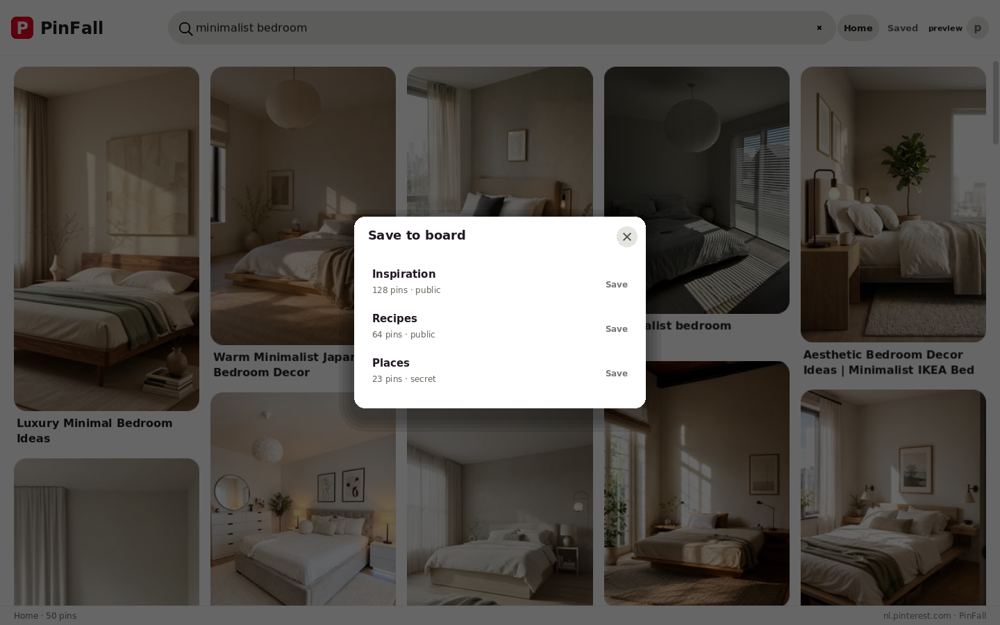

Memory controls — Settings (` , `) and the F3 stats overlay:

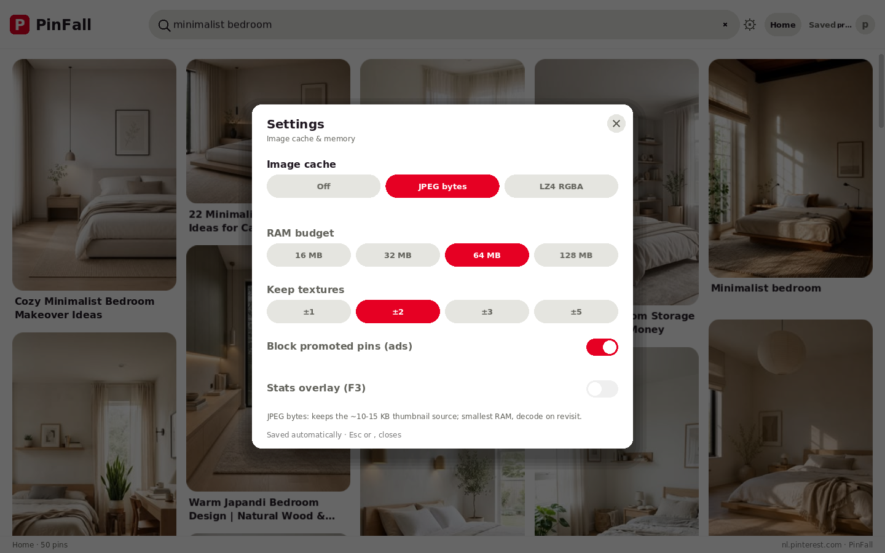

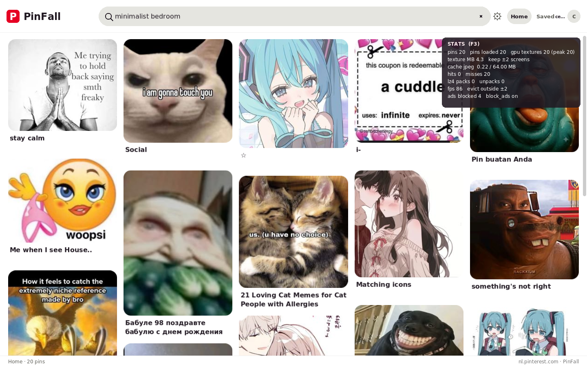

> **Personal-use / research project.** It talks to Pinterest's internal
> `resource/` RPC endpoints as an unauthenticated guest, read-only. It does not
> log in, scrape accounts, or bypass paywalls. Pinterest's terms of service do
> not permit third-party clients; use at your own discretion, keep request rates
> polite, and don't redistribute scraped content.

## Features

- 🔍 Search pins from the real Pinterest index (guest session, no login).
- 🔐 Sign in by importing your **browser's cookies** (works with "Continue with
  Google" too) → personal **Home** feed + your username in the header.
- 📚 **Saved** tab: browse your saved pins (same masonry), paginated.
- 💾 **Save pins**: hover a card → *Save* pill → pick a board (or create one);
  success toast. Guests see the control disabled ("Sign in to save");
  `--no-writes` hides it.
- 🚫 **Ad blocker**: promoted/sponsored pins are filtered out at parse time
  (Settings toggle, on by default) with a live `ads_blocked` counter.
- 🆕 **Create boards in the picker**: name + Public/Secret toggle → the pin is
  saved into the freshly created board with one click.
- 🏷️ **About** panel with the official *powered by dsh* badge (embedded PNG,
  rendered 121×20) linking to DeepSeek Harness.
- 📌 **Pinterest-style close-up**: full image (contained, never cropped), action
  bar (like + comment counts, share, more, Save), real comments with
  "View more", comment composer, and a "More like this" related grid.
- 😄 **Color emoji**: titles, descriptions and comments render emoji through a
  Noto Color Emoji fallback (mixed text/emoji runs, scaled + cached).
- 🎬 **Video & animated pins**: HLS/mp4 videos (and GIF pins, which Pinterest
  serves as short videos) decode through ffmpeg with in-app playback —
  play/pause, looping, autoplay setting, and play badges in the grid.
- 📱 **Android app (pure C)**: official SDL2 Android port — same C codebase, stock
  SDLActivity Java shim only. Mobile UI reverse-engineered from Pinterest's phone
  web (`docs/UI_MOBILE.md`): immersive 2-col feed, bottom nav, close-up, comments
  and save bottom sheets, display-cutout safe areas.
- 🧱 Masonry/waterfall grid, aspect-ratio aware, resizable window.
- 🖼️ Progressive image loading on worker threads — UI never blocks.
- 🧠 **Bounded residency**: textures for off-screen pins are released while you
  scroll; only the ±N-screen band stays on the GPU. RAM cache modes:
  **Off / JPEG-bytes / LZ4-RGBA** with a configurable budget (Settings, `,`).
- ⚙️ **Settings** panel (gear / `,`) + **F3 stats overlay** (textures, texture MB,
  cache hit/miss, LZ4 packs, FPS); settings persist to
  `~/.config/pinfall/settings.conf`.
- 🖱️ Mouse wheel / scrollbar drag / keyboard scrolling (PgUp, PgDn, Home, End).
- 📄 Pin detail view: large image, title, description, board, source domain.
- ⏎ Inline search input with caret editing; Enter searches, Esc dismisses.
- 🚫 Graceful offline/error states instead of crashes.

## Build

Requirements: `gcc`, `libsdl2-dev`, `libsdl2-ttf-dev`, `libcurl4-openssl-dev`,
`libjpeg-dev` (optional fallback). **Runtime:** `ffmpeg` in `PATH` (or
`PC_FFMPEG=/path/to/ffmpeg`) for video/GIF playback. No network needed for
vendored deps after first build (cJSON + stb_image are vendored in `vendor/`).

```sh
make -C pinfall        # builds ./pinfall/pinfall and ./pinfall/tools/dump
```

## Run

```sh
./pinfall/pinfall                      # GUI, default 1440x900
./pinfall/pinfall --query "tattoo"     # start with a search
./pinfall/pinfall --size 1920x1080     # resizable window
./pinfall/pinfall --cookie-file cookies.txt   # signed-in session (Home + Saved)
./pinfall/pinfall --save-session       # remember the imported session
./pinfall/pinfall --no-writes          # read-only: hide all save controls
./pinfall/pinfall --img-cache jpeg --img-budget-mb 64   # cache overrides
./pinfall/pinfall --keep-screens 2      # GPU texture band (1|2|3|5 screens)
./pinfall/pinfall --stats               # F3 stats overlay + machine-readable line

# --- headless / verification modes (no visible window with the right driver) ---
SDL_VIDEODRIVER=offscreen ./pinfall/pinfall --snapshot feed.bmp
SDL_VIDEODRIVER=offscreen ./pinfall/pinfall --snapshot scrolled.bmp --scroll 700
SDL_VIDEODRIVER=offscreen ./pinfall/pinfall --snapshot detail.bmp --detail 2
SDL_VIDEODRIVER=offscreen ./pinfall/pinfall --snapshot login.bmp --auth-preview
SDL_VIDEODRIVER=offscreen ./pinfall/pinfall --snapshot saved.bmp --auth-preview --tab saved
SDL_VIDEODRIVER=offscreen ./pinfall/pinfall --snapshot picker.bmp --auth-preview --open-picker
SDL_VIDEODRIVER=offscreen ./pinfall/pinfall --snapshot settings.bmp --open-settings
SDL_VIDEODRIVER=offscreen ./pinfall/pinfall --snapshot stats.bmp --stats
SDL_VIDEODRIVER=offscreen ./pinfall/pinfall --selftest --auth-preview --prefix /tmp/pf_st

./pinfall/tools/dump "minimalist bedroom"       # terminal API test
./pinfall/tools/dump --auth                    # auth state + username
./pinfall/tools/dump --homefeed -n 5           # personal feed (needs a session)
./pinfall/tools/dump --boards --user pinterest # boards of any profile
./pinfall/tools/dump --user-pins --user pinterest -n 10   # saved pins
PC_ALLOW_WRITE=1 ./pinfall/tools/dump --save <PIN_ID> <BOARD_ID>   # WRITE
./pinfall/tools/membench                       # measure JPEG vs LZ4 RAM/speed
```

Environment:
- `PC_HOST` — base URL, default `https://nl.pinterest.com`.
- `SDL_VIDEODRIVER` — set `offscreen` (or `dummy`) to verify without opening a
  window on a live desktop session.
- `PC_ALLOW_WRITE=1` — required for any CLI write (saving a pin); without it
  `dump --save` refuses before creating a network client.

`--selftest` pushes synthetic SDL events through the real handlers and asserts
scroll, Home, search-submit, click→detail, Esc→close and — with
`--auth-preview` — Saved tab, board-picker open/close and the save round-trip,
printing `PASS`/`FAIL` per step (no display, no X input).

**Writes are explicit only:** saving happens on a click + board choice, never
automatically, never retried, and only when a session is present.

`--snapshot` and `--selftest` force `SDL_VIDEODRIVER=offscreen` when it is not set,
so a verification run can never open a window on a live compositor session.

## Login (browser cookie import)

PinFall **never handles your Pinterest password**. Pinterest's web login is
protected by reCAPTCHA + Arkose FunCaptcha, and "Continue with Google" is Google
Identity Services, which only works inside a real browser. So the supported
sign-in path is the same one `yt-dlp`/Postman use: authenticate in your browser,
then hand the app the resulting cookie jar.

1. Log into <https://nl.pinterest.com> in your browser — email/password **or**
   "Continue with Google"; it makes no difference to the app.
2. Export cookies for `nl.pinterest.com` in **Netscape `cookies.txt`** format
   (e.g. with the open-source *Get cookies.txt LOCALLY* extension, or copy
   `_pinterest_sess`, `_auth`, `csrftoken` from DevTools → Application → Cookies).
3. Save it and run:

```sh
chmod 600 cookies.txt
./pinfall/pinfall --cookie-file cookies.txt     # or: --save-session to remember it
```

A saved session lives at `$XDG_CONFIG_HOME/pinfall/session.txt`
(`~/.config/pinfall/session.txt`), is written `0600`, and is auto-loaded on
startup. The app detects the session with **one** `UserHomefeedResource` probe
and then shows the personal **Home** feed and your username; without a session it
stays a guest client.

**Security:** a `cookies.txt` for a logged-in account is equivalent to your
password — anyone holding it can use your account. Keep it `0600`, never commit
it (`.gitignore` covers `.session-cookies.txt`, `*.cookies.txt`, `session.txt`),
and revoke with Pinterest → *Log out of all devices* if it leaks. The app never
logs cookie values, and passes them only to `pinterest.com`.

`--auth-preview` renders the signed-in header/home layout with a placeholder
username for screenshots and UI testing, without any real session.

## Memory model (textures, JPEG bytes, LZ4)

The feed can hold up to 1200 pins (48 pages), but **memory stays bounded**:

| | before | after |
|---|---|---|
| GPU textures | one per visited pin, never released | only the ±`keep_screens` band (measured **18–24 textures ≈ 4–6 MB** at a 100-pin feed) |
| RAM image cache | decoded RGBA LRU, up to 64 MB (~330 KB/pin) | **JPEG bytes ~11.9 KB/pin** (default) or **LZ4 ~176 KB/pin**, under a budget |
| 327 saved pins | ~105 MB of textures + up to 64 MB RAM | ~5–6 MB textures + **~3.9 MB** JPEG cache (~57 MB if JPEG → RGBA) |

Scrolling past pins calls `SDL_DestroyTexture` for everything outside the band;
scrolling back re-requests the image, which is served from the RAM cache instead
of the network. Measured on a deep-scroll/scroll-back cycle: **24 textures
evicted, cache hits 4 → 26 → 50 while misses stayed flat at 443 → 444**.

### Cache modes (Settings → Image cache, or `--img-cache`)

Benchmarked on 12 real thumbnails by `tools/membench`:

| mode | RAM per pin | 1000 pins | revisit cost | note |
|---|---|---|---|---|
| `off` | 0 | 0 | ~214 ms (re-download) | smallest RAM, slowest revisit |
| `jpeg` *(default)* | **11.9 KB** | **11.4 MB** | 2.7 ms (stb decode) | 28× smaller than RGBA |
| `lz4` | 176 KB | 172 MB | **0.46 ms** (LZ4 unpack) | LZ4 packs RGBA 1.92×, fastest restore |

LZ4 is vendored upstream (`vendor/lz4`, v1.10.1) and built `-O3 -march=native`.
Measured flag sweep: `-O3 -march=native` 1.49 ms pack / 0.26 ms unpack; plain
`-O3` −10 %, `-O2` −18 %, `-flto` slightly worse. **No hand-written asm** was
added: upstream already wins on measurement.

**Not implemented (deliberately):** a custom Vulkan/GL renderer. SDL2's renderer
already draws on the GPU (OpenGL/Vulkan backend), and the RAM cost lives in
decoded pixels, not in the API — a hand-written Vulkan backend would be a
separate rewrite of text/rounded-rect/compositing with no RAM win.

## Emoji

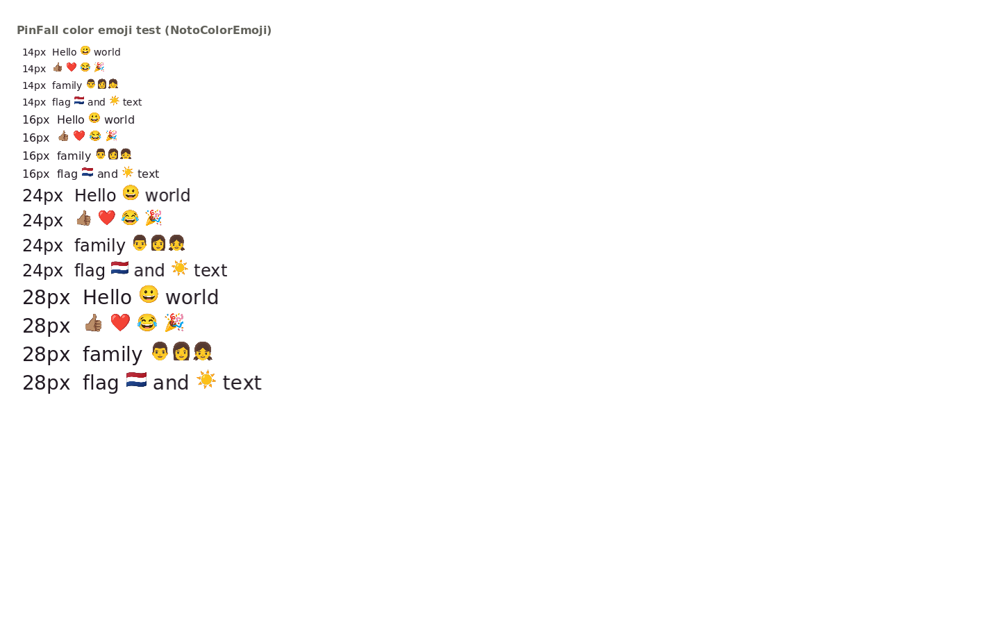

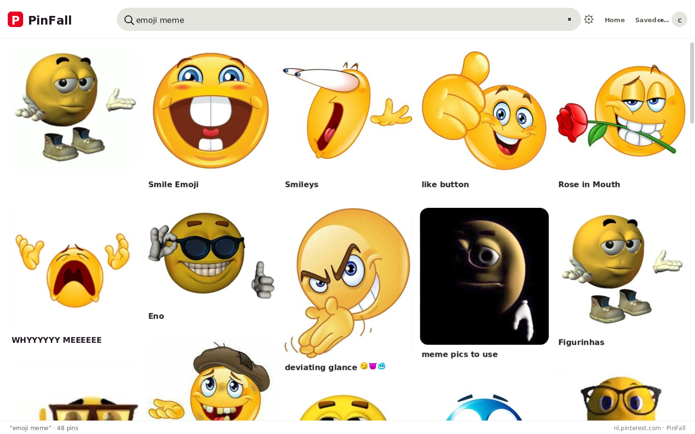

Text is rendered as runs: DejaVu Sans for normal text and **Noto Color Emoji**
for emoji code points (U+2600–27BF, U+1F000–1FAFF, U+2B00–2BFF, flags, with
VS16/skin-tone suffixes). The emoji font is a fixed 136×128 bitmap strike whose
size API is a no-op, so clusters are rendered natively, scaled to ~1.05× the
requested font size and cached; the same run-aware measurement drives wrapping
and ellipsizing, so card titles/comments wrap correctly.

- Font lookup: `PC_EMOJI_FONT`, `$XDG_DATA_HOME/fonts`, `~/.local/share/fonts`,
  `/usr/share/fonts/noto/`, `/usr/share/fonts/truetype/noto/`.
- `--emoji-test <out.bmp>` renders a sample sheet and prints
  `pinfall-emoji: available=… colored_pixels=…`.
- **Limitations:** no glyph-free fallback if the font is missing (emoji are
  stripped as before); ZWJ sequences (family emoji) render as separate
  components; flags render as their two regional-indicator glyphs; skin-tone
  modifiers do not recolor the base; emoji are not tinted by the text colour;
  line height still comes from the primary font, so very tight line boxes can
  clip the ~1.05x emoji slightly.

## Video and animated pins

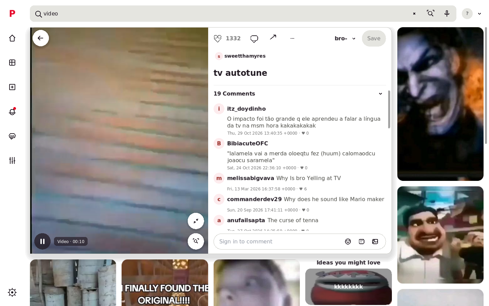

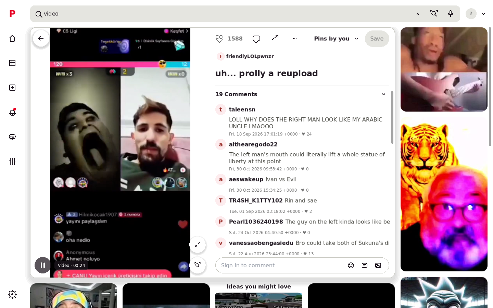

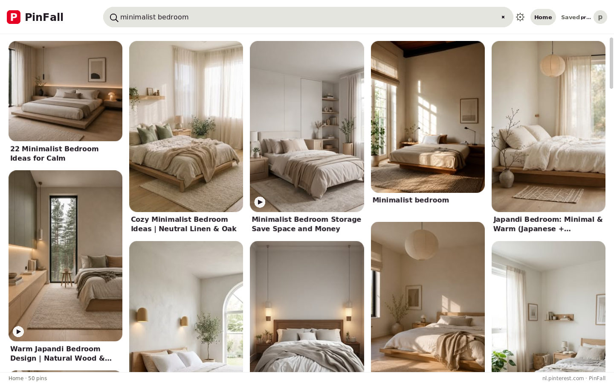

- Detection covers both plain video pins (`videos.video_list`) and **story /
  idea pins**, whose video lives under `story_pin_data.pages[].video` (the feed
  payload can have `videos: null` for those; the client falls back to the REST
  `PinResource` entity during close-up enrichment and then starts playback).
- Pinterest marks video pins with a `videos.video_list` block. The client prefers
  a progressive `mp4` when offered, else `V_HLSV4`/`V_HLSV3` HLS playlists, and
  keeps the pin's thumbnail as the poster until the first frame arrives.
- Decoding is done by a **spawned `ffmpeg` process** streaming raw RGBA frames
  over a pipe (no shell, argv array only; 10 s/frame timeout; clean SIGTERM on
  close). Codec coverage is therefore ffmpeg's: H.264/HLS, GIF, animated WebP…
- Close-up: play/pause button, `Video · MM:SS` label, seamless loop, and a
  `Video unavailable` fallback to the poster. Grid thumbnails get a play badge.
- Settings → **Autoplay videos in close-up** (default on; `--autoplay-video 0|1`,
  or show the poster with a play button when off).
- **Caveats:** audio is muted (video only), frames are decoded at ≤720px wide,
  and Pinterest's HLS uses `.cmfv` segments — handled by passing ffmpeg's
  `-allowed_extensions ALL -protocol_whitelist …` for `.m3u8` inputs only.

## Ad blocking

Pinterest marks paid placements in the resource payload itself, so PinFall can
drop them before they ever reach layout, image loading or the network:

- Filtered on `is_promoted`, `promoted_is_lead_ad`, `is_downstream_promotion`,
  `ad_match_reason` (truthy). **`aggregated_pin_data` is present on ordinary
  pins and is deliberately ignored** — filtering on it would hide a third of the
  feed.
- Applies to search, home and saved feeds (including story-wrapped results);
  board/user objects are untouched.
- Settings → **Block promoted pins (ads)**, on by default; `--block-ads 0|1`
  overrides per run; the F3 overlay / `pinfall-stats` line show
  `ads_blocked=<N> block_ads=<0|1>`.

Verified against captured real ad-bearing payloads: home fixture 12 pins → 9
(3 blocked), search fixture 10 → 9 (1 blocked), with organics carrying
`aggregated_pin_data` surviving. Live, Pinterest frequency-caps ads: a guest
session may see none for a while, while an authenticated `furniture` search
showed 25 → 21 pins with `ads_blocked=3`.

## Close-up (detail view)

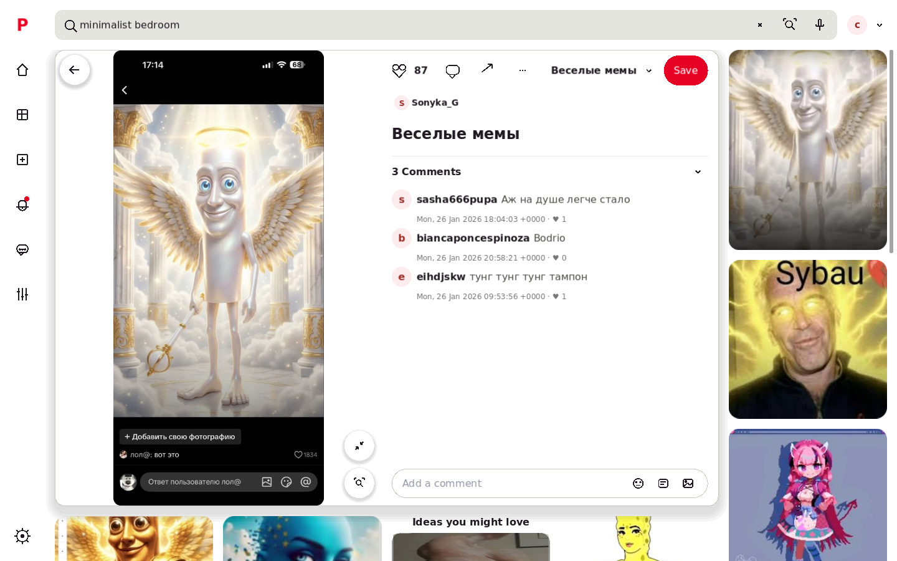

Rebuilt to match Pinterest's own page, from measurements taken off the live site
(headless CDP computed styles + deobfuscated webpack chunks via webcrack — see
[`docs/UI_CLOSEUP.md`](docs/UI_CLOSEUP.md)):

- **App shell**: 72px icon rail, 80px search header, page scrolls; back button
  fixed top-left.
- **Close-up card** (bordered, radius 16, 1px border, soft shadow): image pane
  left (~506px at 1920, contain, v-centered) + info column right (~523px):
  action bar (♥+count, comments, share, more), board dropdown + red Save,
  creator row, title, "Description" block, comments, sticky composer pill.
  Card sizing follows the real formulas recovered from Pinterest's JS:
  `min-height: calc(55vh + 80px)`, image `max-height: calc(90vh − 80px)`,
  description `calc(75vh − 80px)`.
- **Recommendations**: page-wide masonry below/behind the card, using
  `N = max(3, floor((W−80)/240))` columns (7 at 1920, 5 at 1440) with the card
  spanning 4; a two-row **"Ideas you might love"** module is embedded in it.
- **Comments**: 20/page, "View more" only when a next page exists, "No comments
  yet" empty state; counts use the loaded rows once ready (stale payload counts
  can't show "3 Comments" with zero rows).
- **Data**: needs a canonical numeric pin id (`ApiResource /v3/pins/<id>/`
  gives counts + the aggregated id used for comments). Search results use
  `e1_…` entity ids that Pinterest itself cannot resolve on `/pin/`, so those
  show "comments/related unavailable" while Save/Copy/Share still work.
- **Approximated**: Pin Sans → DejaVu, hand-drawn icons, monogram avatars, no
  comment-collapse animation, fixed 24-pin related feed, no ads/visual-search
  modules.
- **Writes** (like/unlike, add comment) are explicit-click only, auth-gated,
  never retried, and verified against a fake server — not against the live
  account.

## Android (pure-C SDL2 port)

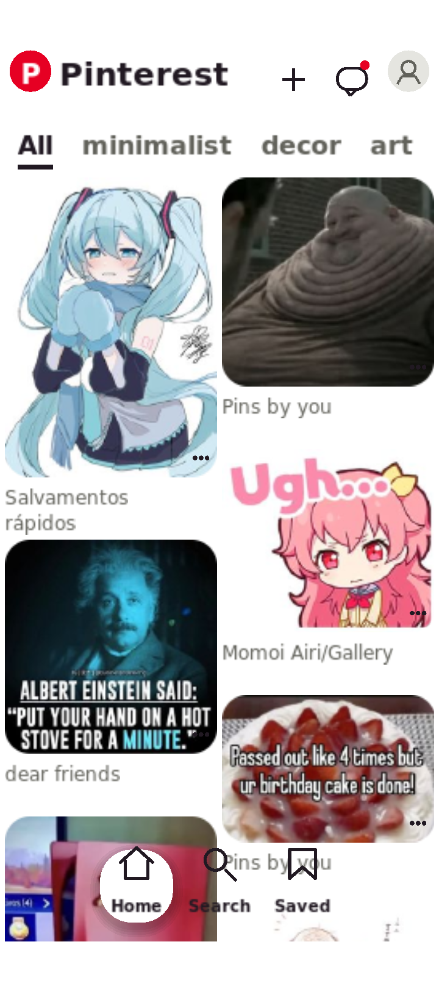

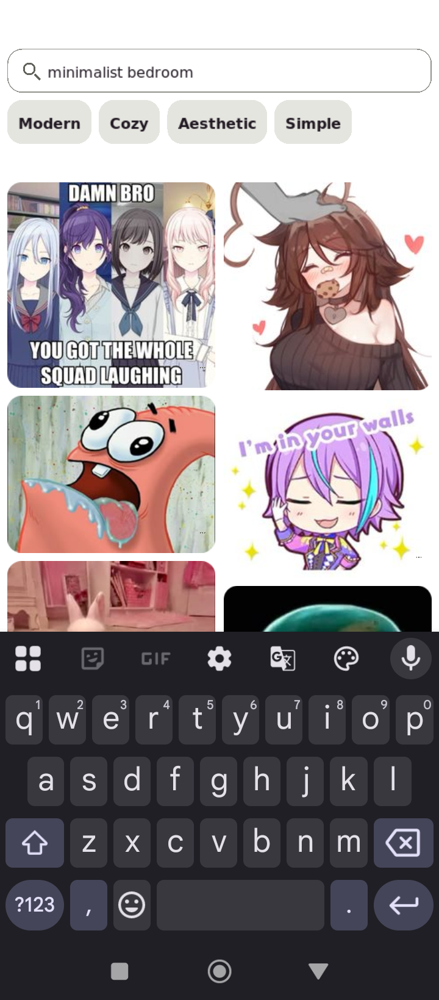

The Android build is the same `src/*.c` codebase compiled with the NDK; Java is
only SDL's stock `org.libsdl.app.SDLActivity` shim (no application Java). The
mobile UI follows the measured Pinterest phone-web spec in
[`docs/UI_MOBILE.md`](docs/UI_MOBILE.md) (412×915 reference, refs in
`assets/ref/mobile/`), adapted to our 432-logical-px renderer.

### Build

```sh
cd pinfall
./android/deps.sh all          # zlib, mbedTLS, freetype, curl, SDL2, SDL2_ttf (arm64 + x86_64)
cd android
ANDROID_HOME=~/Android/Sdk ./gradlew assembleDebug
adb install -r app/build/outputs/apk/debug/app-debug.apk
```

The APK is built for **arm64-v8a only** (x86_64 removed to cut ~4 MB).
Requires Android SDK 34+ with NDK r21+ (tested with NDK 28.2, SDK 35, Java 21).
`android/deps.sh --verify-only all` re-checks the cross-built archives.

### Sign-in on Android

There is no in-app browser login; export cookies once from a desktop browser and
push the Netscape `cookies.txt` to the app's external files dir:

```sh
adb push .session-cookies.txt \
  /sdcard/Android/data/org.pinfall.pinfall/files/cookies.txt
```

The app loads it at startup (or Settings → Profile → **Reload cookies**). Without
it the app runs as a guest (search/feed/close-up work; saving/liking/commenting
needs a session).

### Android-specific behaviour

- Safe areas: status bar / camera cutout and gesture bar are read from
  `WindowInsets` via JNI and excluded from the render viewport (no content under
  the punch-hole). Bottom nav sits above the gesture area.
- Touch: tap opens, drag scrolls, long-press on a grid pin opens the Save sheet,
  Back closes sheets/settings/detail; on-screen keyboard for search and comments.
- Comments and Save use bottom sheets (radius 32, grabber, scrim); the Save sheet
  lists boards with a Create-board row and a red confirm disabled until a board is
  selected.
- **Limitations:** video pins show their poster only (no ffmpeg binary on
  Android); the Inbox tab is omitted (no inbox API); Profile opens the
  account/cookies Settings; portrait only.

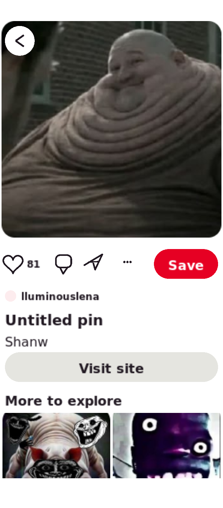

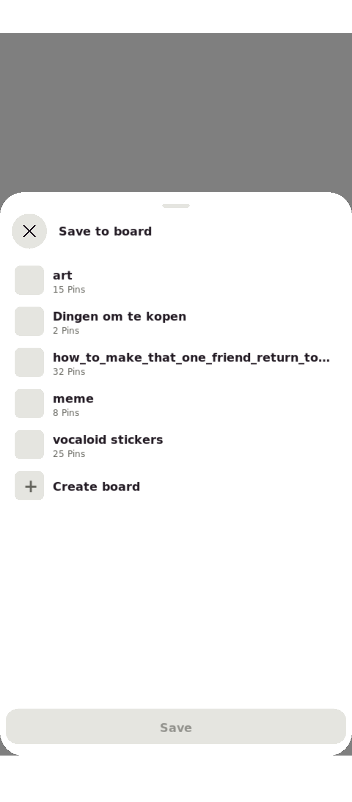

## Documentation

- [`docs/API.md`](docs/API.md) — reverse-engineered guest API: session bootstrap,
  resource RPC, pagination proof, dual-shape parsing, detail gate, rate limits,
  error taxonomy.
- [`docs/UI.md`](docs/UI.md) + [`docs/UI_TOKENS.json`](docs/UI_TOKENS.json) —
  measured layout/typography/palette from the web client, plus SDL2 guidance.
- [`docs/CONTRACT.md`](docs/CONTRACT.md) — verified facts and the frozen
  net↔UI interface this build was split on.
- `assets/ref/` — reference screenshots of the original web client.

## Architecture

```
include/pc.h      frozen interface between net layer and UI
src/http.c        libcurl wrapper: cookie jar, gzip, retries, min-interval
src/api.c         guest bootstrap (csrftoken), search RPC, pagination, detail
src/jsonx.c       dual-shape result parsing (pin item | story wrapper -> pins)
src/img.c         download + stb_image decode + in-memory LRU (thread-safe)
src/layout.c      masonry column packing from aspect ratios
src/render.c      header, search bar, cards, hover overlay, scrollbar, detail
src/font.c        SDL2_ttf font cache + UTF-8 safe wrapping
src/ui.c          state machine, worker threads, event handling
tools/dump.c      CLI acceptance test for the API layer
```

Networking runs on a worker thread; decoded pixels are handed to the renderer via
SDL user events. The UI thread never performs I/O.

## Reverse engineering notes

`docs/API.md` documents the guest session flow and the `resource/` RPC contract,
including the working request shape:

```http
POST /resource/BaseSearchResource/get/?source_url=%2Fsearch%2Fpins%2F%3Fq%3Dcats
Content-Type: application/x-www-form-urlencoded; charset=UTF-8
X-CSRFToken: <csrftoken cookie>
X-Pinterest-AppState: active

data={"options":{"query":"cats","scope":"pins","page_size":25,"bookmarks":[]},"context":{}}
```

`docs/UI.md` documents the layout metrics and palette reconstructed from the web
client. `docs/CONTRACT.md` records the verified facts and the agent/task split
used to build this.

## Known limitations

- **Guest by default**: without an imported session there is no personal home
  feed or personal Saved tab, and saving is disabled. You can still browse any
  public profile's boards and pins as a guest (`dump --boards/--user-pins`).
- **No password login and no in-app Google OAuth**: Pinterest protects `/login/`
  with reCAPTCHA + Arkose FunCaptcha, and Google Identity Services refuses
  embedded/non-browser clients. Cookie import is the only supported sign-in.
- **Saving is auth-gated and unverified live**: `RepinResource/create` exists
  (guests get `401 Authorization failed.`), and the client sends
  `{"options":{"pin_id","board_id"}}`, but the success payload was only exercised
  against a local fake server — a real save cannot be tested without an account
  cookie export. No auto-save, no retries, explicit click only.
- Saved pins of *your own* account need the session; public profiles are
  readable without one.
- **Feed size cap**: up to 1200 pins (48 pages) per feed. Residency is bounded by
  texture eviction, so memory does not grow with that number, but the list itself
  is still capped.
- **No custom Vulkan/GL renderer**: SDL2 already renders on the GPU; the RAM cost
  lived in decoded pixels/textures, which the JPEG/LZ4 cache and eviction now
  bound. A hand-written Vulkan backend would be a separate rewrite with no RAM
  win.
- **Deep pages get slow**: Pinterest thins out deep Saved pagination (measured
  3.9 s/page at page 8 and 9.0 s/page at page 14 while images also load), so
  reaching the end of a 327-pin collection takes a while.
- Pin detail for the new `e1_…` id family is 404 as a guest; with an
  authenticated session it resolves via `unauth_react_main_pin`. Guest mode
  renders the detail overlay from the search payload.
- Some pins are video/product variants without a plain 236x image and are skipped.
- Pinterest can change the RPC contract or challenge sessions at any time;
  the client degrades to an error banner rather than guessing.
- No image disk cache (memory only, 64 MB cap).
- Emoji are rendered via the installed **Noto Color Emoji** font. If that font
  is missing the client falls back to stripping them. ZWJ sequences (family
  emoji) are rendered as their components, and skin-tone modifiers may not
  recolor the base glyph.

## Verification (what was actually tested)

```sh
make -B all                                   # warning-clean
./tools/dump "minimalist bedroom"             # 50 pins, real i.pinimg.com urls
./tools/dump --auth                           # auth=guest (no session present)
./tools/dump --homefeed                       # exit 3 + "login required" (guest)
./tools/dump --boards --user pinterest        # LIVE: 25 boards
./tools/dump --user-pins --user pinterest -n 10 --page 2
#                                             # LIVE: 25 pins p1 / 24 p2, 0 overlap
./tools/dump --save 1 2                       # exit 2: write interlock refuses
PC_ALLOW_WRITE=1 ./tools/dump --save 1 2      # exit 3: login required, 0 POSTs
python3 tools/probe.py search cats --pages 3  # pagination: 0 id overlap
SDL_VIDEODRIVER=offscreen ./pinfall --selftest --auth-preview --prefix /tmp/pf_st
# -> scroll|home|search|detail|close PASS + auth-preview|saved|picker|save|picker-esc PASS
./tools/dump --ads furniture                 # parse-side ad report (see above)
PC_SELFTEST_SEARCH_PAGING=1 ./pinfall --selftest --cookie-file cookies.txt
# -> search paging PASS: 162 pins reached (past the old 75-pin wall)
PC_SELFTEST_PAGING=1 PC_SELFTEST_PAGING_TARGET=200 \
  ./pinfall --selftest --cookie-file cookies.txt
# -> saved=200 PASS; eviction tex 24->21->24, cache misses flat (RAM-cache reloads)
```

Network/parse/image layers were additionally exercised under ASan+UBSan+LSan
(clean), including 8 concurrent image fetches, 3 concurrent searches, cookie/CSRF
propagation, retry-on-429 with `Retry-After`, and a fake server for 403
re-bootstrap. The cookie-login path was verified against a **local fake server**
(authenticated home feed, username parsing, page-2 pagination, authenticated pin
detail) plus a save→load cookie-jar round-trip at mode `0600`. The v3 write path
(`RepinResource/create`) was verified the same way: fake-server success, plus
real 401/400/200-with-failure mapping; the real write is the one thing that needs
a live account session.

## Credits

Vendored: [cJSON](https://github.com/DaveGamble/cJSON) (MIT),
[stb_image](https://github.com/nothings/stb) (public domain),
[LZ4](https://github.com/lz4/lz4) (BSD-2), plus the
[DejaVu](https://dejavu-fonts.github.io/) and
[Noto Color Emoji](https://github.com/googlefonts/noto-emoji) fonts for the
Android build. Full license texts and the rest of the dependency list are in
[THIRD_PARTY_NOTICES.md](THIRD_PARTY_NOTICES.md).

## License

MIT — see [LICENSE](LICENSE).

Pinterest is a trademark of Pinterest, Inc. This is an unofficial, independent
client and is not affiliated with or endorsed by Pinterest.

## Powered by dsh

Built with [DeepSeek Harness](https://github.com/deepseek-ai/deepseek-harness).

[](https://github.com/deepseek-ai/deepseek-harness)

## About

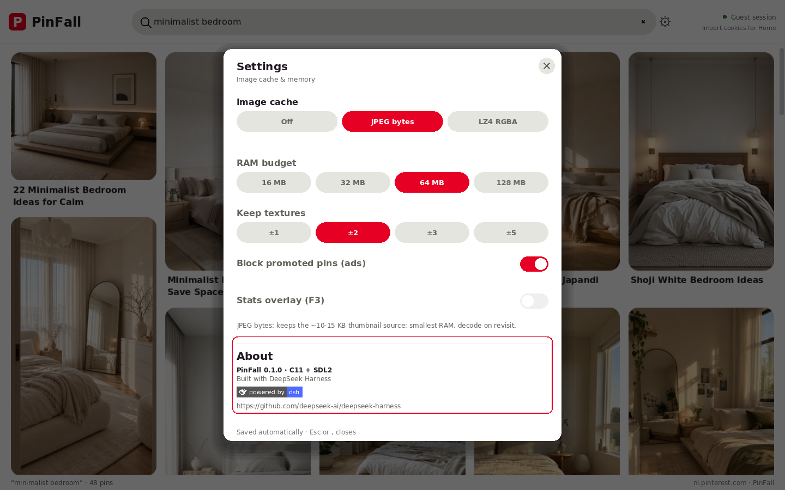

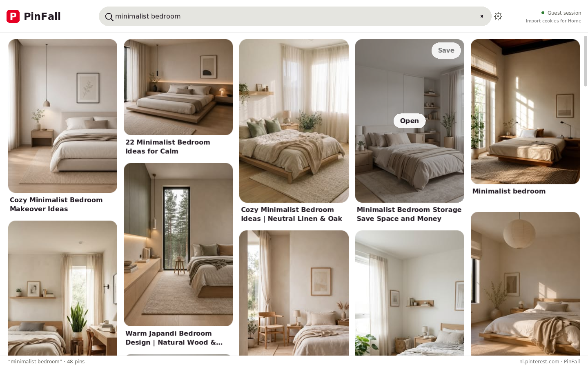

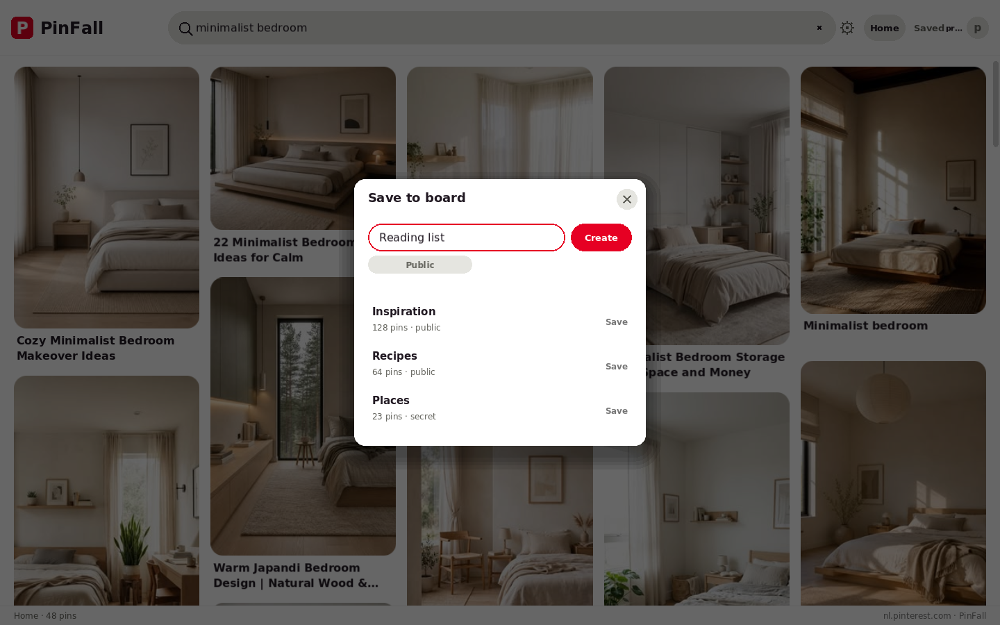
